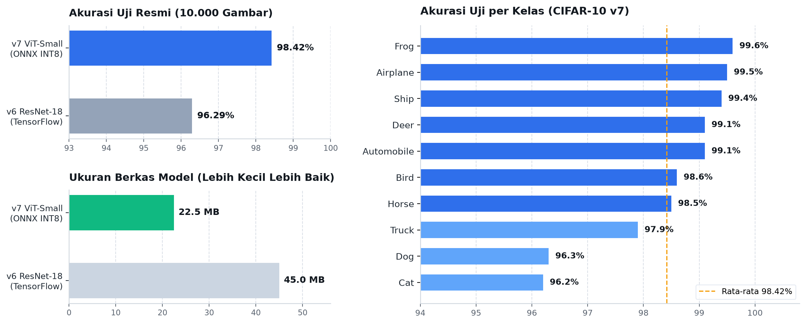
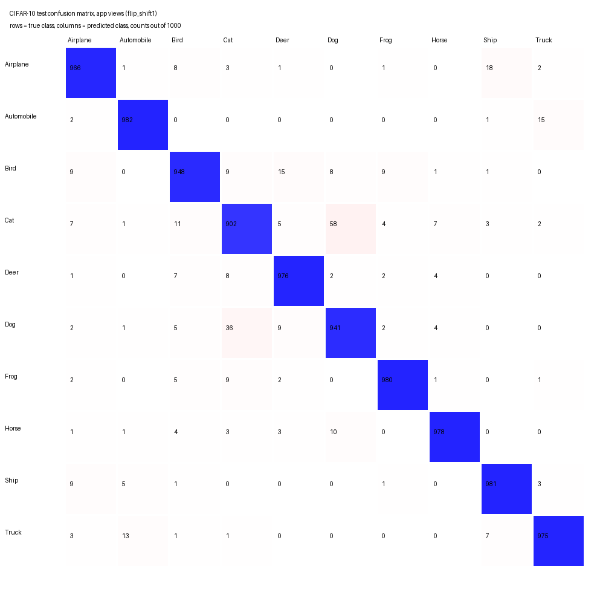

# VisionClassify

Lightweight Streamlit and ONNX Runtime web app achieving **98.42%** CIFAR 10 test accuracy and **82.94%** Top 5 accuracy across **256** general object labels.


## Overview

Upload any JPG, PNG, or WEBP photo to classify objects directly in your browser. Both inference modes run on a unified **ONNX Runtime** backend without TensorFlow for fast startup and low memory usage.

* **CIFAR 10 Mode**: Predicts 10 classic object categories using a quantized **ViT Small/16** model bundled in the repository.
* **General Mode**: Recognizes 256 everyday objects, places, animals, and scenes using zero shot **CLIP ViT B/16** with automatic low confidence detection.

## Screenshots

<table>
  <tr>
    <td align="left" width="50%">
      <br />
      <sub><b>CIFAR 10 Mode</b>: ViT Small INT8 ONNX (10 classes)</sub>
    </td>
    <td align="left" width="50%">
      <br />
      <sub><b>General Mode</b>: CLIP ViT B/16 ONNX (256 labels)</sub>
    </td>
  </tr>
</table>

## CIFAR 10 Mode Performance



<table>
  <thead>
    <tr>
      <th align="left">Metric</th>
      <th align="left">v6</th>
      <th align="left">v7 (Current)</th>
    </tr>
  </thead>
  <tbody>
    <tr>
      <td align="left">Model</td>
      <td align="left">ResNet 18 (32×32)</td>
      <td align="left"><b>ViT Small/16 (224×224)</b></td>
    </tr>
    <tr>
      <td align="left">Test Accuracy (10,000 images)</td>
      <td align="left">96.29%</td>
      <td align="left"><b>98.42%</b></td>
    </tr>
    <tr>
      <td align="left">Model Size</td>
      <td align="left">45.0 MB (<code>.h5</code>)</td>
      <td align="left"><b>22.4 MB (<code>.onnx</code>)</b></td>
    </tr>
    <tr>
      <td align="left">Runtime</td>
      <td align="left">TensorFlow + ONNX</td>
      <td align="left"><b>ONNX Runtime</b></td>
    </tr>
  </tbody>
</table>



* Metrics: [`results/metrics.json`](results/metrics.json)
* Checksum: [`results/model_sha256.txt`](results/model_sha256.txt)
* Verify: `python scripts/eval_cifar_test.py`

## General Mode Performance


<table>
  <thead>
    <tr>
      <th align="left">Metric (1,530 Test Images, 51 Everyday Classes)</th>
      <th align="left">CLIP ViT B/32</th>
      <th align="left">CLIP ViT B/16 + Prompt Ensemble</th>
    </tr>
  </thead>
  <tbody>
    <tr>
      <td align="left">256 Label Top 1</td>
      <td align="left">55.03%</td>
      <td align="left"><b>59.87%</b></td>
    </tr>
    <tr>
      <td align="left">51 Class Top 1</td>
      <td align="left">70.92%</td>
      <td align="left"><b>72.22%</b></td>
    </tr>
    <tr>
      <td align="left">256 Label Top 5</td>
      <td align="left">81.70%</td>
      <td align="left"><b>82.94%</b></td>
    </tr>
    <tr>
      <td align="left">Vision Weights Size</td>
      <td align="left">89.1 MB</td>
      <td align="left"><b>87.5 MB</b></td>
    </tr>
  </tbody>
</table>

* Metrics: [`results/general_metrics.json`](results/general_metrics.json)
* Verify: `python scripts/eval_general.py`

## Quickstart

```bash
python3.11 -m venv .venv && source .venv/bin/activate
pip install -r requirements.txt
streamlit run app.py
```

Run tests with `pip install -r requirements-dev.txt && pytest`.

## License

Released under the [MIT License](LICENSE).
